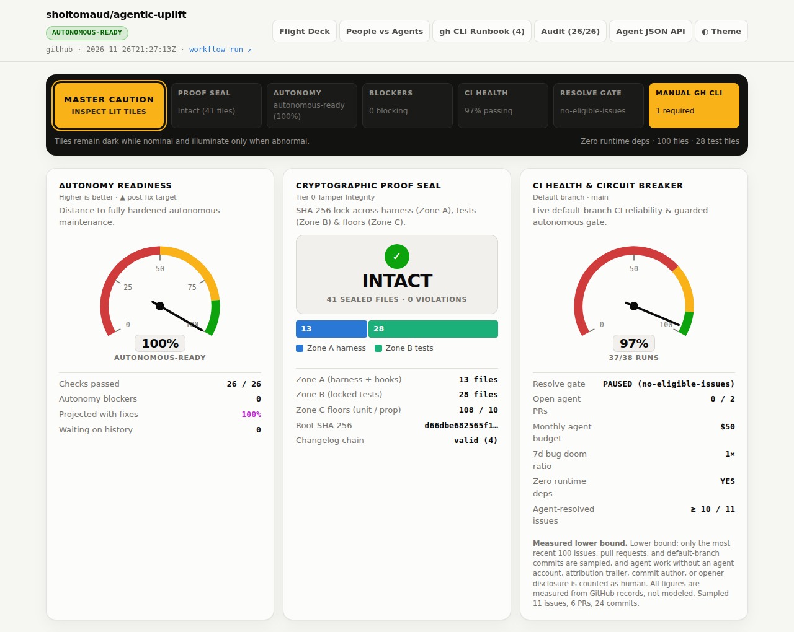

# agentic-uplift

**Audit, cryptographically proof-lock, and govern any GitHub repository for autonomous AI coding agents — with zero runtime dependencies.**

[](https://sholtomaud.github.io/agentic-uplift/)
[](https://github.com/sholtomaud/agentic-uplift/actions/workflows/verify.yml)
[](./package.json)
[](./package.json)
[](./LICENSE)

Synthesizes the operational control plane of [`repo-sre-dashboard`](https://github.com/sholtomaud/repo-sre-dashboard) with the cryptographic verification and tamper-proofing of [`proof-based-development`](https://github.com/sholtomaud/proof-based-development), built entirely on Node.js native TypeScript type stripping (`>=22.18.0`) and buildless Web Components.

## Live Reflexive Demo

This repository runs `agentic-uplift` on itself every 6 hours and publishes both a human flight-deck cockpit and machine-readable JSON endpoints to GitHub Pages:

- **Human cockpit:** [sholtomaud.github.io/agentic-uplift](https://sholtomaud.github.io/agentic-uplift/)
- **Agent endpoints:** [`llms.txt`](https://sholtomaud.github.io/agentic-uplift/llms.txt) · [`status.json`](https://sholtomaud.github.io/agentic-uplift/data/status.json) · [`audit.json`](https://sholtomaud.github.io/agentic-uplift/data/audit.json) · [`proof.json`](https://sholtomaud.github.io/agentic-uplift/data/proof.json) · [`gate.json`](https://sholtomaud.github.io/agentic-uplift/data/gate.json) · [`economics.json`](https://sholtomaud.github.io/agentic-uplift/data/economics.json)

[](https://sholtomaud.github.io/agentic-uplift/)

---

## Add to a Repository in 60 Seconds

Drop `agentic-uplift` onto any existing (pre-agentic) GitHub repository to audit its readiness, get copyable remediation fixes, and track autonomous maintenance safely. Adopt the full control plane or use the composable sub-actions incrementally.

### Option A: Full Control Plane + GitHub Pages Cockpit

Create `.github/workflows/uplift.yml` and enable **Settings → Pages → Build and deployment: GitHub Actions**:

```yaml
name: Agentic Uplift Control Plane

on:
  push:
    branches: [main]
  schedule:
    - cron: '17 */6 * * *'
  workflow_dispatch:

permissions:
  contents: read
  pages: write
  id-token: write
  issues: read
  pull-requests: read
  actions: read

concurrency:
  group: pages
  cancel-in-progress: false

jobs:
  publish:
    runs-on: ubuntu-latest
    environment:
      name: github-pages
      url: ${{ steps.uplift.outputs.page-url }}
    steps:
      - uses: actions/checkout@3d3c42e5aac5ba805825da76410c181273ba90b1 # v7.0.1
        with:
          persist-credentials: false

      - id: uplift
        uses: sholtomaud/agentic-uplift@v1
        with:
          monthly-agentic-budget: '50'
          monthly-human-budget: '20000' # optional; see People vs Agents below
```

### Option B: Audit & JSON API Only (No GitHub Pages Required)

If you want the readiness audit, JSON endpoints, and static cockpit bundle as a downloadable workflow artifact without enabling GitHub Pages, set `deploy-pages: 'false'`:

```yaml
name: Agentic Uplift Audit

on:
  push:
    branches: [main]
  workflow_dispatch:

permissions:
  contents: read
  issues: read
  pull-requests: read
  actions: read

jobs:
  audit:
    runs-on: ubuntu-latest
    steps:
      - uses: actions/checkout@3d3c42e5aac5ba805825da76410c181273ba90b1 # v7.0.1
        with:
          persist-credentials: false

      - uses: sholtomaud/agentic-uplift@v1
        with:
          deploy-pages: 'false'
          out-dir: _site

      - uses: actions/upload-artifact@cf430e030ddbb5b0abf93d22962f4752f3646cd9 # v7.0.2
        with:
          name: agentic-uplift-report
          path: _site
```

### Option C: Composable Sub-Actions

#### 1. Tier-0 Cryptographic PR Tamper Gate (TS/JS, Python, Go, Rust)

Compares every PR against the trusted `origin/<base>:proof-lock.json` so autonomous agents cannot silently weaken tests or forge the lockfile:

```yaml
- uses: sholtomaud/agentic-uplift/actions/proof-gate@v1
  with:
    base-ref: origin/${{ github.base_ref }}
```

#### 2. Proof-Aware Autonomous Resolution Circuit Breaker

Pauses autonomous agent runs automatically if the proof seal breaks, open agent PRs reach the cap, measured monthly agentic spend hits budget, or default-branch CI goes red:

```yaml
- id: gate
  uses: sholtomaud/agentic-uplift/actions/resolve-gate@v1
  with:
    max-open-agent-prs: '2'
    monthly-agentic-budget: '50'
```

---

## Why `agentic-uplift`?

Running autonomous agents against a repository requires a closed loop across both **operations** and **proof integrity**:

1. **Observe & Audit (Offline or GitHub API):** Measure autonomy readiness across 6 pillars (*Proof integrity*, *Code & CI*, *Supply chain & security*, *Agent operating model*, *Issues & delivery*, *Observability & budgets*) with machine-actionable fixes and verify commands.
2. **Seal Cryptographically (Tier 0, Language-Agnostic):** Hash Zone A (verification harness, workflows, `.githooks/`), Zone B (existing tests), and Zone C (monotonic test-count floors + skip ceiling) in `proof-lock.json` and chain commit attestations in `PROOF_CHANGELOG.md`.
3. **Block Bad Commits Early (Layer 1 Local Hooks) & Tampered PRs Unbypassably (Layer 2 CI Gate):** Tracked `.githooks/pre-commit` and `.githooks/pre-push` stop LLMs locally, and `.githooks/commit-msg` requires every commit to reference a GitHub issue claimed for its branch (`Picking up as branch …`, see [`AGENTS.md`](./AGENTS.md)); `actions/proof-gate` compares PRs against `origin/<base>:proof-lock.json` so agents cannot forge the lockfile.
4. **Gate Autonomous Resolution (Proof-Aware Circuit Breaker):** `actions/resolve-gate` automatically pauses autonomous agent runs if the proof seal breaks, open agent PRs reach the cap, monthly agentic spend hits budget, or default-branch CI goes red.
5. **Query Programmatically (Agent-First JSON API):** Every CLI command supports `--json`, `query <expr>` queries structured state directly, and published Pages bundles expose `data/{status,audit,proof,gate,economics}.json`, `schemas/*-v1.json`, and `llms.txt`.

---

## Quick Start (Local CLI — Zero `npm install` Required)

Requires **Node.js 22.18+ / 24+ / 26+**:

```bash
# Run the full 4-tier deterministic verification pipeline
node src/cli.ts verify

# Install tracked pre-commit, commit-msg & pre-push bash guardrails
node src/cli.ts hooks install

# Run the offline readiness audit as machine-readable JSON
node src/cli.ts audit --json

# Query any field or filtered slice directly (first-class agentic query)
node src/cli.ts query status.summary
node src/cli.ts query audit.readiness.blockers
node src/cli.ts query "audit.checks[status!=pass,blocks_autonomy=true].id"
node src/cli.ts query proof.ok
node src/cli.ts query gate.decision

# Publish JSON APIs + schemas + llms.txt + zero-dep Web Components cockpit
node src/cli.ts publish --out _site
node src/cli.ts serve --dir _site
```

---

## People vs Agents Economics (`data/economics.json`)

`publish --github` also writes `data/economics.json` (schema
`schemas/economics-v1.json`) and a *People vs Agents* cockpit panel comparing
issues resolved by people and by agents. Every figure is tagged:

- **measured**: observed in GitHub records (resolved counts, elapsed time, time
  to first PR, review rounds, reverts, reopens, CI minutes, compliance shares,
  agent-reported token usage and run time);
- **modeled**: derived from stated assumptions and a dated, sourced price table
  (`src/domain/price-table.ts`), always reported as a `{ low, high }` range
  ($ per issue, hands-on hours, budgets, savings).

The resolve gate pauses on **measured** agentic spend only, never on a modeled
range. Agents can make their cost measured by adding one line per run to the PR
description or squash commit:

```text
Agent-Usage: model=claude-opus-5-5 input_tokens=1200000 output_tokens=45000 cache_read_tokens=800000 run_minutes=18
```

Tune assumptions in an optional `costs` block of `uplift.config.json` (every
key is optional; ranges are `{ "low": n, "high": n }`):

```json
{
  "costs": {
    "humanHourlyRate": 120,
    "monthlyHumanBudget": 20000,
    "monthlyAgenticBudget": 500,
    "agentModel": "claude-sonnet-5-5",
    "copilotSeats": 3,
    "copilotPlan": "copilot-business",
    "handsOnHours": { "security": { "low": 4, "high": 16 }, "bug": { "low": 2, "high": 8 }, "other": { "low": 1, "high": 6 } },
    "reviewHoursPerRound": { "low": 0.25, "high": 1 },
    "revertHours": { "low": 1, "high": 4 },
    "ciMinuteUsd": 0.006,
    "priceOverrides": { "claude-opus-5-5": { "inputPerMTok": 3.5, "outputPerMTok": 17.5 } }
  }
}
```

The root action takes the most common ones as inputs (`monthly-human-budget`,
`human-hourly-rate`, `copilot-seats`, `agent-model`, `monthly-agentic-budget`).
The pay-off history (readiness vs savings) accumulates across publishes by
reading the previous `data/economics.json` from the output directory, `--history
<file>`, or the deployed Pages site.

---

## Visual Snapshot Tests (Isolated)

`.github/workflows/visual.yml` diffs cockpit screenshots (desktop 1024 px and
phone 390 px, light and dark) against `visual/snapshots/`, using frozen
fixture data in `visual/fixture/data/`. Playwright is installed only inside a
digest-pinned `mcr.microsoft.com/playwright` container from
`visual/package-lock.json`; the root `package.json` stays dependency-free.

To regenerate baselines, run the workflow with *update-baselines* and commit
the `visual-baselines` artifact to `visual/snapshots/`, or run the same
container locally:

```bash
docker run --rm -v "$PWD":/work -w /work --ipc=host \
  mcr.microsoft.com/playwright:v1.63.0-noble@sha256:eff16c30e6f3f4af0a03fa4b706120d5e9b0891c344a27d64559aff5900a4a27 \
  bash visual/run.sh --update-snapshots
```

When `visual/snapshots/` does not exist yet, the workflow generates baselines
and uploads them as an artifact instead of failing.

---

## Architecture (Enforced by `src/core/arch-check.ts`)

| Layer | Directory | Rules |
| --- | --- | --- |
| **0. Shared Contracts** | `src/shared/` | Pure types & runtime guards only; zero `node:*` imports |
| **1. Pure Domain** | `src/domain/` | Audit engine, proof verifier, resolve-gate, SRE metrics, query engine + formal `check*Invariants()`; zero `node:*` or DOM globals |
| **2. Core Engine** | `src/core/` | Filesystem proof I/O, local repo scanner, architectural checker, static anti-pattern verifier, JSON Schema validator |
| **3. Adapters** | `src/adapters/` | Native-`fetch` GitHub REST collector, JSON API & static cockpit publisher |
| **4. Entrypoint & UI** | `src/cli.ts`, `site/` | Single zero-dep CLI + buildless native Web Components cockpit with live Agent Query Bar |

---

## Contributing (Humans & AI Agents Welcome)

Pull requests from both humans and autonomous coding agents are welcome under our issue-first, proof-locked operating model:

- Read [`CONTRIBUTING.md`](./CONTRIBUTING.md) and [`AGENTS.md`](./AGENTS.md) before opening a PR.
- Pick or open an issue first, claim it (`Picking up as branch …`), and verify locally with `node src/cli.ts verify`.
- Report security issues privately via [`SECURITY.md`](./SECURITY.md) and follow [`CODE_OF_CONDUCT.md`](./CODE_OF_CONDUCT.md).